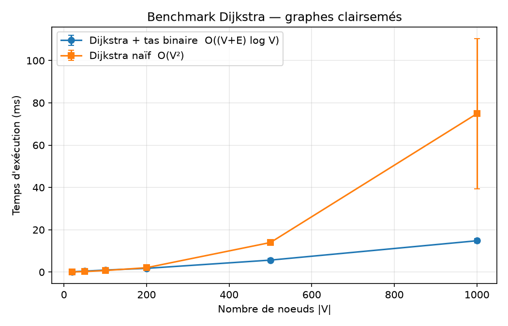
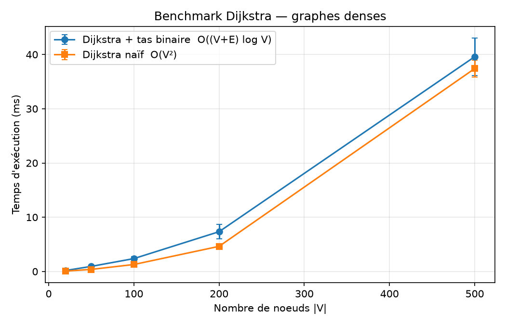

# Note d'analyse de complexité — Dijkstra (QueenBee, UC-C01)

Notations : *n* = |V| (nombre de sommets), *m* = |E| (nombre d'arêtes), *s* = sommet source, *w(u, v)* ≥ 0 le poids d'une arête, *d[v]* la distance provisoire et δ(s, v) la vraie distance minimale.

## 1. Correction de l'algorithme

**Invariant.** Au moment où un sommet *u* est extrait du tas pour la première fois (et marqué `visited`), on a *d[u]* = δ(s, u).

**Justification.** Supposons le contraire et prenons le premier sommet *u* extrait avec *d[u]* > δ(s, u). Sur un plus court chemin de *s* à *u*, soit *y* le premier sommet non encore visité et *x* son prédécesseur, qui est déjà visité. Quand *x* a été traité, l'arête (x, y) a été relâchée, donc *d[y]* = δ(s, y). Comme les poids sont positifs ou nuls, δ(s, y) ≤ δ(s, u) < *d[u]*. On a donc *d[y]* < *d[u]*, et le tas aurait dû extraire *y* avant *u* : c'est une contradiction.

L'hypothèse *w* ≥ 0 est indispensable. C'est pourquoi le code rejette les poids négatifs (`ValueError`).

## 2. Complexité de la version avec tas binaire : O((|V| + |E|) log |V|)

L'implémentation utilise la **suppression paresseuse** : quand une distance s'améliore, on ré-insère le sommet au lieu de faire un *decrease-key*, et les entrées périmées sont ignorées à l'extraction.

**Étape 1 — initialisation.** La création des tableaux `distances` et `predecessors` coûte O(n).

**Étape 2 — nombre de relâchements.** Un sommet n'est développé qu'une seule fois, grâce à l'ensemble `visited`. Ses arêtes sortantes ne sont donc parcourues qu'une fois. Le nombre total de relâchements est Σ deg(u) = O(m).

**Étape 3 — nombre d'opérations sur le tas.**
- Insertions : 1 pour la source, plus au plus 1 par relâchement réussi. On a donc au plus m + 1 insertions.
- Extractions : on n'extrait que ce qu'on a inséré, donc au plus m + 1 extractions.
- Taille maximale du tas : m + 1.

**Étape 4 — coût d'une opération.** Le tas est un arbre binaire presque complet, de hauteur ⌊log₂ k⌋ pour k éléments. `insert` (remontée) et `extract_min` (descente) parcourent au plus cette hauteur, soit O(log(m + 1)). Comme m ≤ n², on a log m ≤ 2 log n, donc **O(log m) = O(log n)**.

**Étape 5 — total.**

T(n, m) = O(n) + (m + 1) · O(log n) [insertions] + (m + 1) · O(log n) [extractions] + O(m) [relâchements]
        = **O((n + m) log n)**

**Mémoire.** O(n + m) : les tableaux de distances et de prédécesseurs, plus un tas d'au plus m + 1 entrées.

**Remarques.**
- Avec un tas à *decrease-key* (tas indexé), on aurait n extractions et m diminutions, ce qui donne la même borne O((n + m) log n), pour un code plus complexe. La suppression paresseuse garde la borne tout en simplifiant le tas.
- `heapify` coûte O(n) par l'algorithme de Floyd : la somme des hauteurs des nœuds est O(n). Il n'est pas utilisé dans Dijkstra, car le tas est rempli au fil de l'eau.
- Le redimensionnement du tableau du tas (doublement) coûte O(1) amorti par insertion.
- La reconstitution du chemin coûte O(longueur du chemin) ≤ O(n).
- L'arrêt anticipé, qui s'arrête dès que la ruche cible est extraite, ne change pas le pire cas mais réduit le coût moyen pour l'endpoint.

## 3. Complexité de la version naïve : O(|V|²)

À chacune des n itérations, le sommet non visité le plus proche est cherché par **parcours linéaire** de l'ensemble non visité, de taille n, puis n − 1, etc.

- Recherche du minimum : Σ_{k=1..n} k = n(n + 1)/2 = O(n²).
- Relâchements : O(m), chaque arête étant parcourue une fois.
- Total : O(n² + m) = **O(n²)**, puisque m ≤ n².

## 4. Comparaison théorique

| Type de graphe | m | Avec tas | Naïf | Meilleur |
|---|---|---|---|---|
| Clairsemé (réseau de pistes, degré borné) | Θ(n) | O(n log n) | O(n²) | **Tas** |
| Dense | Θ(n²) | O(n² log n) | O(n²) | **Naïf** |

La version avec tas devient avantageuse quand (n + m) log n < n², c'est-à-dire en gros quand **m < n² / log n**. Sur un graphe complet, le tas fait m · log n opérations alors que le naïf n'en fait que n².

## 5. Résultats du benchmark

Le protocole est implémenté dans `python -m src.benchmark` :
- graphes aléatoires connexes, poids dans [1, 20] ;
- 3 graines par taille ;
- pour chaque graphe, meilleur temps sur 3 exécutions, mesuré avec `time.perf_counter()` ;
- résultats présentés en moyenne ± écart-type sur les 3 graphes.

Seul l'algorithme est chronométré, pas la construction du graphe. À chaque mesure, on vérifie que les deux versions donnent exactement les mêmes distances. La colonne « opérations » compte les comparaisons (dans le tas, ou lors de la recherche linéaire) plus les relâchements. Environnement : Python 3.14, Windows, une seule machine.

### Graphes clairsemés (m ≈ 3n, cas réaliste d'un maillage de pistes)

| Nœuds | Arêtes | Tas (ms) | Naïf (ms) | Rapport naïf/tas | Opérations tas | Opérations naïf |
|---:|---:|---:|---:|---:|---:|---:|
| 20 | 60 | 0.149 ± 0.035 | 0.059 ± 0.004 | 0.40 | 230 | 270 |
| 50 | 150 | 0.438 ± 0.004 | 0.229 ± 0.001 | 0.52 | 832 | 1 425 |
| 100 | 300 | 0.953 ± 0.028 | 0.734 ± 0.002 | 0.77 | 1 881 | 5 350 |
| 200 | 600 | 1.759 ± 0.164 | 2.067 ± 0.118 | 1.17 | 4 327 | 20 700 |
| 500 | 1500 | 5.656 ± 0.841 | 13.973 ± 0.568 | 2.47 | 12 740 | 126 750 |
| 1000 | 3000 | 14.807 ± 0.958 | 74.869 ± 35.457 | 5.06 | 28 577 | 503 500 |

### Graphes denses (m ≈ n²/4)

| Nœuds | Arêtes | Tas (ms) | Naïf (ms) | Rapport naïf/tas | Opérations tas | Opérations naïf |
|---:|---:|---:|---:|---:|---:|---:|
| 20 | 107 | 0.180 ± 0.020 | 0.071 ± 0.001 | 0.39 | 347 | 317 |
| 50 | 641 | 0.937 ± 0.063 | 0.382 ± 0.024 | 0.41 | 2 021 | 1 916 |
| 100 | 2549 | 2.374 ± 0.320 | 1.284 ± 0.222 | 0.54 | 6 376 | 7 599 |
| 200 | 10133 | 7.333 ± 1.322 | 4.632 ± 0.534 | 0.63 | 20 239 | 30 233 |
| 500 | 62678 | 39.595 ± 3.468 | 37.408 ± 1.570 | 0.94 | 97 798 | 187 928 |

## 6. Interprétation

**Les taux de croissance confirment la théorie.** Sur les graphes clairsemés, quand on passe de 200 à 500 nœuds (n multiplié par 2,5) :
- la version naïve est multipliée par **6,8**, ce qui est cohérent avec n², dont le facteur théorique est 2,5² = 6,25 ;
- la version avec tas est multipliée par **3,2**, ce qui est cohérent avec n log n, dont le facteur théorique est 2,5 × log 500 / log 200 ≈ 2,9.

De 500 à 1000 nœuds, on retrouve la même tendance : le naïf est multiplié par 5,4 (théorie : 4) et le tas par 2,6 (théorie : 2,2). L'écart avec la théorie y est plus grand pour le naïf, car la mesure à n = 1000 est bruitée (écart-type de 35 ms, voir plus bas).

Le nombre d'opérations, qui ne dépend pas de la machine, est plus fiable que le temps. Celui du naïf suit presque exactement n²/2 : 503 500 opérations pour n = 1000. À cette taille, le naïf fait **17,6 fois plus d'opérations** que le tas, pour un temps seulement 5 fois plus long. Une opération sur le tas coûte donc environ 3,5 fois plus cher qu'une comparaison de la boucle naïve.

**Le seuil de rentabilité se situe entre 100 et 200 nœuds sur graphe clairsemé.** Le rapport naïf/tas passe de 0,77 à 100 nœuds à 1,17 à 200 nœuds. En dessous de ce seuil, le naïf est plus rapide malgré sa complexité. Une opération sur le tas (comparaison de tuples, échanges, appels de méthodes en Python pur) coûte beaucoup plus cher qu'une comparaison dans la boucle linéaire. Les constantes cachées par la notation O dominent donc pour les petits n. Au-delà du seuil, l'écart grandit avec la taille : 2,5 fois plus rapide à 500 nœuds, 5 fois à 1000 nœuds.

**Sur graphe dense, le tas ne gagne jamais.** Le rapport naïf/tas reste inférieur à 1 pour toutes les tailles, et les deux versions sont presque à égalité à n = 500 (0,94). Le tas fait pourtant moins d'opérations comptées que le naïf à partir de 100 nœuds, mais chacune coûte plus cher. C'est le résultat prévu par la section 4 : avec m = Θ(n²), le tas est en O(n² log n) contre O(n²) pour le naïf.

**Écarts-types.** Les écarts-types sont faibles dans l'ensemble, sauf pour le naïf à n = 1000 sur graphe clairsemé (74,9 ± 35,5 ms). Cette dispersion vient de l'environnement d'exécution (autres processus, ordonnanceur du système), pas de l'algorithme : son nombre d'opérations est identique d'une exécution à l'autre. C'est pour limiter ce bruit qu'on garde le meilleur temps sur 3 répétitions. Même avec la valeur basse de l'intervalle (environ 39 ms), le naïf reste plus de 2,5 fois plus lent que le tas.

## 7. Conclusion pour QueenBee

Le maillage des pistes et accès d'un site est un **graphe clairsemé**. Chaque carrefour ou ruche n'est relié qu'à quelques voisins, donc m = O(n). C'est exactement le cas où la version avec tas binaire est asymptotiquement et pratiquement meilleure. Le choix du tas est donc justifié pour l'endpoint `/api/v1/routing/emergency-path`, d'autant que l'arrêt anticipé sur la ruche cible réduit encore le travail.

Sur le petit graphe de démonstration (≈ 25 nœuds), le calcul prend moins de 0,1 ms quelle que soit la version. Le gain devient significatif à l'échelle du réseau complet des 400 ruches et de leurs points de passage.

**Limites de l'étude.**
- Les mesures sont faites en Python interprété ; dans un langage compilé, les constantes et donc le seuil de rentabilité changent.
- Les graphes sont aléatoires et non issus des données réelles du site.
- Les mesures proviennent d'une seule machine.